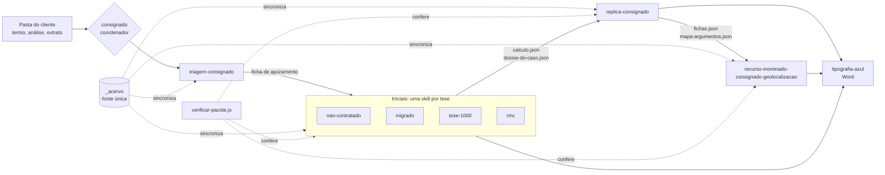
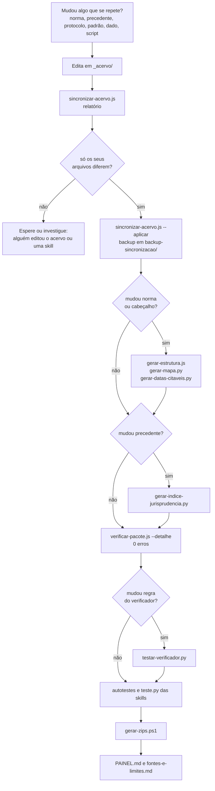

# Arquitetura técnica do pacote de consignado

Para: quem mantém o pacote. Não é manual de uso (esse é o [MANUAL.md](../MANUAL.md)) nem guia de replicação para outro ramo (esse é o [DIRETRIZES-DE-REPLICACAO.md](DIRETRIZES-DE-REPLICACAO.md)). Este documento explica **como o pacote funciona por dentro**: o que cada peça faz, como se ligam e como se mantém.

**Escopo e estado verificado.** Escrito em 06/11/2026 a partir da leitura dos arquivos e da execução dos verificadores sobre a árvore de trabalho (que tem alterações ainda não commitadas). Resultado conferido nesse dia:

| Conferência | Resultado em 06/11/2026 |
|---|---|
| `verificar-pacote.js` | 9 skills, **0 erros**, 9 avisos (cabeçalho 1, peças 4, checagem 4) |
| `sincronizar-acervo.js` (relatório) | 284 cópias iguais, 0 faltam, 0 diferem |
| `escrutinio.py --teste` | autoteste OK |
| `cabecalhos.py` | **3 faltas e 3 lacunas da fonte** (seção 11) |
| `testar-verificador.py` | cópia limpa passa e **53 de 53 defeitos reprovam** (rodado depois de corrigir 3 trechos defasados; seção 7.2) |

Onde este texto diz "decisão do escritório", a origem está no [PAINEL.md](PAINEL.md) e nas `NOTA-*.md` da raiz. Regra jurídica **não** é repetida aqui: ela vive no protocolo e muda com o tempo.

---

## 1. Visão geral

O pacote é um conjunto de nove skills do Claude que levam um cliente de consignado do INSS da triagem ao recurso. A ideia central: **o modelo escreve e raciocina, mas tudo o que pode ser verificado mecanicamente é tirado dele** (número, citação, data, juízo, estrutura da peça).



**Decisões de desenho que explicam o resto:**

1. **Corte de skill por tese × etapa**, não por função. Uma skill de inicial por tese; réplica e recurso à parte. Cada passagem entre skills perde contexto, então as fases (extrair, pesquisar, redigir, revisar) ficam **dentro** de cada skill, apoiadas em scripts.
2. **Acervo fechado.** A skill só cita norma e precedente que estão nos arquivos dela. O que não está vira `[CONFERIR]`.
3. **Fonte única + cópia.** Os arquivos que se repetem entre skills são editados num lugar (`_acervo/`) e copiados por script.
4. **Verificador independente do modelo.** Regra que só existe no texto da skill depende da disciplina do modelo e não conta como garantida; o que importa é escrito como regra do verificador e provado por defeito plantado.
5. **Dois ambientes.** No Cowork (executa código) os scripts rodam. No chat o modelo faz a conta em tabela e o portão de cálculo fica pendente (seção 11).

---

## 2. Anatomia de uma skill

Cada skill é uma pasta com `SKILL.md` e, conforme o papel, as subpastas abaixo. Os nomes de pasta são fixos porque o manifesto os usa (seção 3).

| Caminho | Conteúdo | Vem do acervo? |
|---|---|---|
| `SKILL.md` | frontmatter (`name` igual ao da pasta; `description` com no máximo 1.024 caracteres, regra `descricaoMax` do verificador) e o fluxo | não |
| `protocolo/protocolo.md`, `quadro-de-fatos.md` | regras comuns e modelo do quadro de fatos | sim |
| `protocolo/fontes-e-limites.md` | o que o acervo da skill cobre e não cobre | **não**: é próprio de cada skill |
| `assets/` | `modelo-*.md` (modelo da peça), `padrao-pecas.md`, `escrutinio-fsc-vf.md`, `padrao-figuras.md`, `ba_municipios.json` | padrões e dados sim; **modelo não** |
| `references/` | `01-tese-e-roteiro.md`, `02-mudancas-no-modelo.md` (ou o equivalente da skill) | não |
| `references/normas/` | textos literais das normas, mais `INDEX.md`, `MAPA.md`, `ESTRUTURA.md` | normas sim; os três índices são **gerados por skill** |
| `references/jurisprudencia/` | súmulas, temas, acórdãos; `INDEX.md` por assunto; `datas-citaveis.md` | fichas sim; `INDEX.md` gerado |
| `references/dados/` | `reus.json`, `tjba_unidades.json`, `tjba_comarcas.json`, `trf1_jurisdicao.json`, `territorial-tjba.md` | sim |
| `scripts/` | cálculo, extrato, escrutínio, figuras | sim (cópias), mais o script próprio da skill |
| `testes/caso-ficticio/` | extrato fictício, ficha, `teste.py`, `saida/` com peça e registros de exemplo | não |

**Variações.**
- `consignado` (coordenador) tem só `SKILL.md` e `protocolo/`. Não redige, só roteia.
- `triagem-consignado` tem `protocolo/`, `references/` (tabelas TJBA e TRF1) e `scripts/triagem.py`. Não tem `assets/`: não gera peça.
- `recurso-inominado-consignado-geolocalizacao` veio da skill de recurso em uso e mantém o estilo antigo: `SKILL.md` de 502 linhas, em quatro etapas numeradas, com `REGRAS ABSOLUTAS` e checklist final. Tem a pilha de geolocalização e o conjunto congelado do mapa (seção 7).
- `tipografia-azul` tem só `SKILL.md`: é a especificação de estilo do Word, sem scripts na pasta.

**Carregamento progressivo.** O Claude lê só a descrição da skill até ela ser acionada. Depois o `SKILL.md` manda ler o protocolo e o padrão de peças e, para buscar fonte, seguir uma escada que evita ler arquivo inteiro:

1. **Norma:** `INDEX.md` (para que serve cada norma) → `MAPA.md` (um dispositivo por linha, com o número da linha do arquivo) → `ESTRUTURA.md` (Parte, Livro, Título, Capítulo, com intervalos de linha). No Cowork, lê-se só a janela (`Read offset/limit`); no chat, procura-se `Art. N` no arquivo.
2. **Precedente:** `jurisprudencia/INDEX.md`, organizado por **assunto da peça**, que avisa quais precedentes o banco pode invocar contra o cliente.

Esses três índices existem porque o CPC, o CC e a CF têm de 600 a 700 KB cada: ler inteiro estoura o contexto.

**Skills do pacote e seus scripts** (conferido nas pastas em 06/11/2026):

| Skill | Scripts próprios | Scripts do acervo (cópia) |
|---|---|---|
| `triagem-consignado` | `triagem.py` | nenhum (leitor de extrato próprio) |
| `nao-contratado` | `calcular.py` | `extrato.py`, `escrutinio.py`, `valores.py`, `buscar_reu.py` |
| `migrado` | `calcular_migrado.py` | `extrato.py`, `escrutinio.py`, `valores.py`, `buscar_reu.py` |
| `tese-1000` | `calcular_1000.py`, `diagramas_1000.py` | `extrato.py`, `escrutinio.py`, `valores.py`, `buscar_reu.py`, `figuras.py` |
| `rmc` | `calcular_rmc.py`, `diagramas_rmc.py` | `cartao.py`, `escrutinio.py`, `valores.py`, `buscar_reu.py`, `figuras.py` |
| `replica-consignado` | (nenhum próprio) | `fichas.py`, `extrato.py`, `escrutinio.py`, `valores.py`, `buscar_reu.py`, `geo_check.py`, `geo_malha.py`, `ip_check.py`, `catalogo_indicadores.json` |
| `recurso-inominado-…-geolocalizacao` | `geo_figuras.py`, `geo_compor.py`, `geo_dados_figura.py`, `geo_mapa_pmtiles.py`, `exemplo_entrada.json` | `geo_check.py`, `geo_malha.py`, `ip_check.py`, `catalogo_indicadores.json` (nomes iguais aos do acervo; ver nota abaixo) |

Nota: no manifesto, `geo_check.py`, `geo_malha.py`, `ip_check.py` e `catalogo_indicadores.json` estão listados só para `replica-consignado`. O recurso tem arquivos de mesmo nome, que **não** são sincronizados pelo manifesto (foram copiados do recurso para a réplica e para o acervo). Edite com cuidado: uma correção feita no acervo não chega ao recurso sozinha.

---

## 3. O acervo como fonte única

`_acervo/` guarda o que se repete entre skills. `_acervo/manifesto.json` diz quem recebe o quê.

```
_acervo/
├── manifesto.json            versão, mapa de pastas e lista de arquivos por skill
├── fontes-e-limites.md       registro geral de fontes, datas e níveis
├── normas/                   23 normas em Markdown literal, com cabeçalho YAML
├── jurisprudencia/           19 arquivos + bibliotecas stf/ e stj/ (estas NÃO vão às skills)
├── pecas/                    padrao-pecas.md, escrutinio-fsc-vf.md, padrao-figuras.md, ba_municipios.json
├── protocolo/                protocolo.md, quadro-de-fatos.md
├── dados/                    réus, comarcas, unidades do TJBA, jurisdição do TRF1
└── scripts/                  extrato, escrutínio, valores, figuras, buscar_reu, fichas, geo, cartão
```

**Mapa de pastas do manifesto** (campo `pastas`): o que está em `protocolo` do acervo vai para `protocolo/` da skill; `pecas` vai para `assets/`; `normas` e `jurisprudencia` para `references/normas` e `references/jurisprudencia`; `dados` para `references/dados`; `scripts` para `scripts/`.

**Estado em 06/11/2026:** 64 arquivos no manifesto, 284 cópias distribuídas. Dois arquivos estão no acervo **sem destino** (lista vazia, intencional): `normas/res-bcb-96-2021.md` (conta de pagamento; retirada como base) e `normas/res-cmn-4753-consolidada.md` (conta de depósitos; idem). O verificador proíbe citá-los.

**Regra de ouro:** edita-se no acervo, nunca na cópia. Se alguém editou direto numa skill, `--trazer` leva a edição de volta ao acervo.

### O sincronizador (`sincronizar-acervo.js`)

| Comando | Efeito |
|---|---|
| (sem flag) | relatório: iguais, faltam, diferem. **Não grava** |
| `--aplicar` | copia do acervo para as skills; o arquivo antigo vai para `_manutencao/backup-sincronizacao/<data-hora>/`; nunca apaga |
| `--skill <nome>` / `--arquivo <trecho>` | restringe o alcance |
| `--incluir <skill> <pasta/arquivo>` | a skill passa a usar o arquivo (acrescenta ao manifesto) |
| `--trazer <skill> <pasta/arquivo>` | skill → acervo (para quem editou na skill por engano) |

`criar-acervo.js` foi o script de uso único que criou o acervo e o manifesto a partir da duplicação existente.

### Cabeçalho (front matter YAML)

Toda norma e todo julgado do acervo começa com um cabeçalho. Norma: `ato_data`, `publicacao_dou`, `vigencia`, `situacao`, `fonte`, `consulta`. Julgado: `data_julgamento`, `data_publicacao_acordao`, `situacao`, `fonte`, `consulta`. `cabecalhos.py` grava (`--gravar`) e valida (sem flag; sai com código 1 se faltar campo). `gerar-datas-citaveis.py` lê as bibliotecas `stj/` e `stf/` e gera `datas-citaveis.md`, o único arquivo dessas bibliotecas que chega às skills: a skill lê as datas ali, sem consultar a web e sem pedir conferência ao advogado.

---

## 4. O protocolo comum

[`_acervo/protocolo/protocolo.md`](../_acervo/protocolo/protocolo.md) vale para todas as skills. O documento traz **só a regra vigente**: data, motivo e alternativa descartada ficam no `PAINEL.md`. Isso é deliberado: regras empilhadas com datas confundem o modelo quando o contexto enche.

**Seções** (nesta ordem): Abertura e roteamento · Quadro de fatos · Fontes · Presunções do escritório · Regras de citação e de pedido vigentes · Texto vigente e texto revogado · Cálculos · Dados pessoais · Portões de qualidade e entrega · Proporcionalidade · Formato de entrega.

### 4.1 Roteamento

Tabela única (no protocolo, seção "Abertura e roteamento") que liga o estado do processo à skill. O coordenador aplica a tabela; não escolhe por conta própria.

| Estado | Skill |
|---|---|
| termo + análise, sem ficha | `triagem-consignado` |
| não contratado (B, C, Caixa) | `nao-contratado` |
| migrado (A) | `migrado` |
| Tese 1000 contra (E) | `tese-1000` |
| refinanciamento de cartão RMC/RCC (D) | `rmc` |
| contestação juntada | `replica-consignado` |
| sentença desfavorável | `recurso-inominado-consignado-geolocalizacao` |
| formatação | `tipografia-azul` |

**Rota fechada.** Antes de passar a vez, o coordenador fecha, por processo: benefício, réu, tese, etapa, skill, contratos, documentos, respostas do advogado e bloqueios. Campo obrigatório vazio vira pergunta e o processo não segue. A especialista é lida **por inteiro** antes de executar, e os portões e pausas dela continuam valendo. Esse formato está descrito em `consignado/SKILL.md`; no Cowork a rota fica em `roteamento.json` e, no chat, em uma linha por processo no Painel do Caso (conforme as Diretrizes, seção 8; não localizei um `roteamento.json` de exemplo na árvore).

**Unidade de processo:** um por benefício + banco + tese. Mesmo banco em outro benefício, ou em outra tese, gera processo separado.

### 4.2 Quadro de fatos

Um quadro por processo. Cada fato tem **estado** (`confirmado`, `relatado`, `inferido`, `desconhecido`), valor e **proveniência** (documento e página). Relato do cliente nunca vira prova na peça. Na inicial não há ID de processo: o documento é citado pelo nome, como anexo; ID e página só em réplica e recurso. Ao fim de cada etapa a skill escreve o **resumo de continuidade**.

### 4.3 Presunções e regras vigentes

Duas seções separadas, de propósito:
- **Presunções do escritório:** fatos presumidos confirmados pelo cliente, escritos **sem marca** (natureza alimentar do benefício, cliente não consultado, ciência pela data de emissão do extrato, ausência de tentativa administrativa, entre outras). **Cedem ao documento:** se um documento dos autos mostrar o contrário, prevalece o documento e a skill avisa.
- **Regras de citação e de pedido vigentes:** tabela do que citar e do que nunca citar.

Sem as presunções, a peça viraria um mar de `[CONFERIR]` que ninguém lê.

### 4.4 Juízo e fecho sem pergunta

Decisão de 03/11/2026: o endereçamento e a cidade do fecho saem do **endereço do autor**. A triagem acha a comarca do TJBA ou a subseção do TRF1; `escrutinio.foro()` grava em `calculo.json`, chave `foro`, o endereçamento do rito escolhido e o fecho (cidade-sede do juízo, UF BA). O verificador reprova fecho ou endereçamento diferentes do `foro` e o campo `[FECHO…]` sobrando. Só o **rito** continua sendo pergunta.

A tabela de unidades (`tjba_unidades.json`, explicada em `territorial-tjba.md`) distingue as 40 comarcas com Vara do Sistema dos Juizados das demais, onde o JEC corre na vara cível "pelo procedimento da Lei nº 9.099/95". Réu Caixa: Vara Federal da subseção do TRF1.

### 4.5 Os quatro portões

Registrados ao fim de cada resposta como `passou`, `pendente` ou `bloqueado`:

1. **Fatos e enquadramento:** rito confirmado, foro, tese e skill, contratos contra termo e análise, status de cada contrato, competência, idade, gratuidade, litispendência.
2. **Prova e cálculo:** cada argumento ligado a documento; tabela de descontos, dobro e valor da causa conferida por segunda via.
3. **Contraditório, "a sentença que perderíamos":** checagem FSC1 a FSC12 e verificações VF1 a VF9 (seção 5.4). **FSC ATIVADO que a peça não trata, ou PENDENTE_ADVOGADO sem resposta, deixa o portão 3 pendente.**
4. **Revisão final:** citações, valores, pedidos, competência, prazos e dados pessoais, pelo checklist da seção 9 de `padrao-pecas.md`.

Dois portões falhos: só diagnóstico ou minuta com a **Observação interna "BLOQUEADO PARA USO FINAL"** no topo, listando o que falta.

### 4.6 Marcas de pendência

| Marca | Significado |
|---|---|
| `[CONFERIR: …]` | falta dado ou fonte |
| `[PREENCHER: …]` | campo sem informação |
| `[VERIFICAR ANTES DE PROTOCOLAR: …]` | tese ou citação que depende do juízo do advogado |
| `[DECISÃO DO ADVOGADO: …]` | escolha que é dele |
| `[CÁLCULO A CONFERIR]` | número produzido por script |

No Word saem com **realce amarelo** de caractere, aplicado pela `tipografia-azul`, nunca como página amarela. Marcador de condicional `[[SE …]]` do modelo que sobre na peça gerada é erro do verificador. **Peça com marca não está pronta para protocolo.**

### 4.7 Texto vigente e texto revogado

O acervo mantém o texto revogado riscado (`~~…~~`) porque ele pode reger fatos da época. A skill fixa **antes a data do fato** e usa a norma daquela data (tabela "Texto vigente e texto revogado"): IN 28/2008 até 12/12/2022 e IN 138/2022 desde 13/12/2022 (decisão D30), Res. CMN 3.954 até 31/1/2022 e 4.935 depois, e assim por diante.

---

## 5. Scripts e cálculo

Todos são Python 3 com biblioteca padrão, exceto onde indicado. Requisitos: Node 18+; `pypdf` para ler extrato; `Pillow` para figuras; `PyMuPDF` para recortes do extrato e para extrair tabelas; Playwright e Chromium só para os mapas de rua do recurso.

### 5.1 Leitura de documento

| Script | Faz | Observação |
|---|---|---|
| `extrato.py` | lê os contratos do Histórico de Empréstimo Consignado (PDF do INSS): contrato, banco, seção (ativo ou excluído), situação, início e fim dos descontos, parcelas, valor da parcela, origem da averbação, datas de inclusão e exclusão, valor liberado, motivo da exclusão; lê também a data de emissão | o PDF não traz coluna utilizável; o script usa a **ordem estável das células**. Herdado do AMN v1.4 e **só testado com extrato fictício** (D18) |
| `cartao.py` | lê o cartão RMC/RCC e o histórico mensal; detecta o refinanciamento (competência em que o "utilizado no mês" salta para quase todo o saldo, com IOF); monta a planilha acumulada e o marco de 200% | mesma ressalva (D18) |
| `triagem.py` | cruza análise × termo (× extrato) e gera a ficha de ajuizamento | o texto do termo é **sempre limpo antes** do cruzamento (páginas juntadas, rodapé do ZapSign, números quebrados). Nenhum contrato é dado como "não autorizado" sem busca no texto compactado e de números parecidos |
| `buscar_reu.py` | qualifica o banco réu: código do banco → ISPB (BrasilAPI) → CNPJ da matriz → dados da Receita | só devolve a qualificação se o CNPJ tem dígitos válidos, a situação é ATIVA e a razão social bate com o BCB; senão devolve `None` e o motivo. Nunca inventa. Usa a rede |

### 5.2 Cálculo (um script por tese)

`calcular.py` (não contratado), `calcular_migrado.py`, `calcular_1000.py`, `calcular_rmc.py`. Uso típico:

```
python3 scripts/calcular.py --ficha ficha.json --processo N --extrato extrato.pdf --data AAAA-MM-DD --saida pasta/ [--rito jec|comum] [--extrato-bancario sim|nao] [--dossie-pre-acao]
```

**Regras de conta** (protocolo, seção "Cálculos"):

- quantidade de descontos = meses de "Início" a "Fim", **inclusive**; zero se a exclusão é anterior ao primeiro desconto;
- contrato ativo conta até a competência do mês anterior à data da peça;
- restituição = dobro do total descontado;
- dano moral fixo de R$ 20.000,00;
- valor da causa = dobro + dano moral + proveito econômico declaratório (parcelas vincendas dos ativos; no RMC, o saldo refinanciado), sempre, em qualquer rito (CPC, art. 292, II e VI). No JEC, alerta se passar de 40 salários mínimos; Vara Federal usa valor real;
- **todo total tem segunda via**: o script enumera mês a mês e soma de novo por outro caminho.

**Travas** (o script para sem gravar, em vez de estimar): sem histórico completo (RMC), sem refinanciamento detectado, 200% não atingido antes do refinanciamento, mais de um cartão no processo, nenhum derivado localizado (Tese 1000).

**Alertas** (gravam e avisam, sem bloquear): contrato sem origem de migração; troca de titularidade (o script **não soma** os descontos do outro banco sem `--incluir-outros-bancos`, que é decisão do advogado); refinanciamento antes do prazo de 90 dias da Lei 14.690 (era bloqueio B2, virou alerta pela decisão D19).

**Particularidades por tese:**

| Script | Detalhe |
|---|---|
| `calcular_migrado.py` | identifica a origem da migração e o banco anterior; procura o mesmo número no banco anterior |
| `calcular_1000.py` | acha o derivado e o contrato-raiz (número sem sufixo); mede o intervalo entre a exclusão da raiz e a **primeira** averbação do derivado em qualquer banco; escolhe a norma pela data dessa averbação |
| `calcular_rmc.py` | marco de 200% do capital, aceito como limite do cartão (D20); aceita `--historico-extra historico.csv` (`MM/AAAA;valor;fonte`) para competências ausentes |

**Valor por extenso:** `valores.py` formata em reais no estilo do escritório e foi testado contra 74 valores de petições reais (`nao-contratado/testes/casos-reais/teste_extenso.py`).

### 5.3 Saídas padronizadas

| Arquivo | Conteúdo | Quem grava | Quem consome |
|---|---|---|---|
| `calculo.json` | todos os números da peça, mais a chave `foro` | `calcular*.py` | modelo da peça; verificador (confere cada valor da peça) |
| `calculo.md` | tabela para o advogado | `calcular*.py` | advogado |
| `checagem-fsc-vf.md` | registro FSC1 a FSC12 e VF1 a VF9 | `escrutinio.gravar()` | advogado; verificador |
| `dossie-do-caso.json` | checagem + **linha do tempo** do caso | `escrutinio.gravar()` | réplica e recurso |
| `figuras.json` + `fig_*.png` | figuras e legendas | `diagramas_*.py` | peça; verificador (17 cm a 300 dpi) |

### 5.4 Escrutínio FSC e VF (`escrutinio.py`)

É o módulo que implementa o portão 3. Recebe os contratos lidos do extrato e devolve, para cada FSC e cada VF, um **status** e o **achado**.

- **FSC** (fundamentos de sentença que perderíamos), números 1 a 12. Status: `ATIVADO` (o risco existe e a peça precisa tratá-lo), `OK`, `NAO_SE_APLICA`, `PENDENTE_ADVOGADO`.
- **VF** (verificações forenses), números 1 a 9. Status: `EXECUTADA`, `NAO_SE_APLICA`, `PENDENTE_ADVOGADO`.
- O que o extrato permite apurar sozinho é **calculado** (FSC4, FSC5, FSC6, FSC11; VF3, VF6, VF7, VF8). O resto fica `PENDENTE_ADVOGADO`.
- Funções de uso comum: `checagem()`, `para_markdown()`, `foro()`, `eventos_dos_contratos()` e `cronologia()` (linha do tempo: averbação, descontos, exclusão, ciência, prescrição), `gravar()`.
- O registro **não entra na peça**: é registro de trabalho. O catálogo em si (texto de cada FSC e VF, gatilho, onde a peça trata) está em [`assets/escrutinio-fsc-vf.md`](../_acervo/pecas/escrutinio-fsc-vf.md).
- Autoteste: `python3 _acervo/scripts/escrutinio.py --teste`. Um autoteste que falha em silêncio é defeito (já aconteceu; seção 11).

### 5.5 Réplica: fichas e mapa de argumentos

`fichas.py` **não lê o PDF do banco**. Quem lê é o advogado (ou o modelo, página a página), que registra os dados em `contestacao.json`, cada um com ID e página. O script cruza isso com o extrato e grava:

- `fichas.md` e `fichas.json`: ficha de cada contrato impugnado e quadro de indícios, com gravidade `CRÍTICO`, `RELEVANTE`, `REFORÇO`, `PROCESSUAL` ou `ALERTA_CONTRA` (o achado que pesa contra o cliente e **exige decisão expressa**);
- `mapa-argumentos.json` e `.md`: uma linha por ponto da contestação, com o código do catálogo (`P1…`, `M1…` ou `NOVO`), resposta e fonte (de `references/02-defesas-do-banco.md`, 21 defesas típicas), provas e o **pedido** da réplica que atende o ponto. Acrescenta sozinho os contratos sem defesa (M11) e a substituição de objeto (M12).

Defesa fora do catálogo sai como `NOVO` com `[DECISÃO DO ADVOGADO]`. Se aparecer duas vezes, vira linha do catálogo. Pedido que não seja "procedência" entra em `PEDIDO_POR_DEFESA` do `fichas.py`.

### 5.6 Geolocalização e IP (réplica e recurso)

| Script | Faz |
|---|---|
| `geo_check.py` | VF9. Distância entre o ponto do log do banco e a **residência do autor** (referência única). Python puro, sem rede, sem enviar dado. Aponta inconsistência; não pondera a força da fonte |
| `ip_check.py` | classifica IP: público, rede interna, CGNAT, reservado (offline) e, opcionalmente, titular do bloco por RDAP (`--sem-rdap` desliga a consulta, que envia o IP ao registro público). Não localiza ninguém por IP |
| `geo_malha.py` | malha municipal da Bahia (IBGE 2025), simplificada. Devolve `perto_da_divisa` para avisar quando o ponto está a menos de cerca de 100 m de uma divisa |
| `geo_figuras.py`, `geo_compor.py`, `geo_mapa_pmtiles.py` | (recurso) três figuras por evento: A visão geral (malha do IBGE, offline); B e C capturas de mapa de ruas lidas de `regiao.pmtiles`, com MapLibre e Chromium sem janela, sem rede |

O `regiao.pmtiles` **não vem na skill** (passa de 30 MB): o advogado gera uma vez (`references/mapa_offline_pmtiles.md`).

### 5.7 Figuras

`figuras.py` implementa o padrão de [`padrao-figuras.md`](../_acervo/pecas/padrao-figuras.md): desenha no tamanho da página (largura útil de 17 cm, 300 dpi, fonte mínima de 9 pt), com blocos (cabeçalho, caixas, seta, faixa, linha do tempo, gráfico, legenda, recorte de documento, frase, rodapé). `diagramas_1000.py` e `diagramas_rmc.py` o usam. O recorte de extrato rasteriza a página (PyMuPDF) e localiza o trecho pelas coordenadas do texto; **só reproduz o documento**, sem nada escrito por cima, só o contorno da linha que prova a tese. A figura não introduz fato novo.

---

## 6. Contrato de dados entre etapas

O que passa de uma etapa para a seguinte. Todos são **roteiro, não prova**: a skill seguinte reconfere nos autos.

| Artefato | Origem | Destino | Para quê |
|---|---|---|---|
| `ficha.json` (ficha de ajuizamento) | triagem | inicial | processos, réus, contratos, skill de cada um |
| `calculo.json` | inicial | inicial, réplica, recurso | números e `foro` |
| `dossie-do-caso.json` | inicial | réplica, recurso | checagem FSC/VF, linha do tempo, residência |
| `contestacao.json` | advogado, na réplica | `fichas.py` | dados dos documentos do banco, com ID e página |
| `fichas.json`, `mapa-argumentos.json` | réplica | recurso | indícios e mapa pontos × respostas × pedidos |
| resumo de continuidade | cada etapa | conversa nova | retomar o caso sem repetir pergunta |

Para retomar em outra conversa: colar o resumo de continuidade e anexar `calculo.json` e `dossie-do-caso.json` (da inicial), ou `fichas.json` e `mapa-argumentos.json` (da réplica). Um cliente por conversa.

---

## 7. Verificação

A verificação é o que separa "o modelo disse" de "o pacote garante". Há três camadas.

### 7.1 O verificador (`verificar-pacote.js` + `verificador.config.js`)

O **motor** (`verificar-pacote.js`) é genérico, sem dependências além de Node 18+. As **regras do setor** ficam em `verificador.config.js` (cerca de 200 linhas; cada regra nasceu de um erro real e a mensagem cita a decisão). Código de saída 0 sem erros, 1 com erros; avisos não reprovam.

```
node _manutencao/verificar-pacote.js              resumo
node _manutencao/verificar-pacote.js --detalhe    lista também os avisos
node _manutencao/verificar-pacote.js --raiz <pasta> --config <arquivo>
```

| Tipo de regra | O que confere | Exemplos de regra |
|---|---|---|
| Cópias | arquivo distribuído igual ao acervo, pelo manifesto | protocolo, padrão de peças, scripts |
| Estrutura do pacote | `name` igual à pasta; descrição ≤ 1.024 caracteres; skill citada existe | skills `semProtocolo`, `semPecas` |
| Existência | citação tem arquivo e dispositivo no acervo | artigo, súmula, tema, acórdão por número |
| Transcrição | todo trecho entre aspas ou em bloco `>` atribuído a norma ou precedente existe, **letra a letra**, no arquivo da skill | ementa do TRF-4; tese do EAREsp 676.608; ementa sem arquivo reprova |
| Número | cada valor da peça bate com o `calculo.json` ao lado | valor da causa, dobro por contrato |
| Estrutura da peça | o que o escritório exige | fecho "Termos em que, pede deferimento.", tópico de precedentes, art. 55 da Lei 9.099 |
| Proibição | o que não pode voltar | Tema 929 como fundamento, MP 1.393, Res. CMN 4.753, tratamento "Excelentíssimo", nome da ação em caixa alta |
| Exigência condicionada | quando X aparece, exige Y | "barreira técnica" exige `[CONFERIR]` da fonte |
| Coerência | ligações entre artefatos | registro FSC/VF ao lado de cada peça; 12 linhas FSC e 9 linhas VF; FSC3 na peça; FSC9 conforme o rito; negativa específica de cada contrato |
| Mapa de argumentos | todo ponto tem resposta e pedido; pedido do mapa consta de "Dos pedidos" | `mapa-argumentos.json` ao lado de réplica e recurso |
| Figuras | tamanho 2.008 px a 300 dpi (17 cm) | `fig_*.png` |
| Congelados | hash SHA-256 dos arquivos do mapa e da geolocalização do recurso bate com `testes/mapa/congelados.json` | 32 arquivos, segundo o `PAINEL.md` (não recontei) |
| Resíduos | marcador `[[SE …]]` sobrando, caractere de substituição, `R$ 0,00`, campo de modelo não preenchido | |

**Normalização de comparação** (`normalizar.js`): `norm` ignora espaço, marcas de revogação (`~~`), pipes, ênfase e maiúsculas, e trata `º`/`°` como `o`; `soLetras` mantém só letras sem acento. A comparação "só letras" é a que pega diferença de quebra de linha e numeração, mas **tem um limite**: acha "depende" dentro de "independe" (erro 18 das Diretrizes). Por isso os defeitos de teste trocam palavras inteiras.

**Avisos atuais (06/11/2026):** 9 avisos (cabeçalho 1, peças 4, checagem 4), todos não reprovam. Para ver a lista: `--detalhe`.

### 7.2 Teste do verificador (`testar-verificador.py`)

Prova que cada regra dispara. Copia o pacote para uma pasta temporária, confirma que a cópia limpa passa e aplica **um defeito de cada vez**, conferindo que cada um reprova com a mensagem certa. Não altera o pacote.

```
python3 _manutencao/testar-verificador.py --tmp <pasta temporária>
```

**Estado em 06/11/2026: 53 defeitos, todos reprovados, cópia limpa aprovada** (o número das Diretrizes, 46, e o da `ROTINA.md`, 28, estavam defasados). Demora vários minutos; rode em segundo plano.

**Fragilidade conhecida.** Os defeitos citam trechos literais das peças de exemplo, e a função de troca falha com `AssertionError` quando o trecho não existe. Quando uma peça de `testes/**/saida/` é regerada, o teste pode quebrar sem relação com o verificador. Isso aconteceu em 06/11/2026: a peça de `nao-contratado` passou a trazer o valor da causa `R$ 46.810,20` e o endereçamento `AO JUÍZO DA __ª VARA…` (decisões de 03 e 05/11), e três defeitos ainda procuravam `R$ 39.730,20` e `[N]ª VARA`. Foram corrigidos em `testar-verificador.py` (linhas 75, 89 e 91). **Depois de regerar qualquer peça de exemplo, rode este teste.**

**Regra de ouro:** cada erro que aparece duas vezes vira regra nova em `verificador.config.js`, com um defeito novo em `testar-verificador.py`. E vale o corolário: **veja o defeito falhar antes de confiar na regra**.

### 7.3 Testes por skill

| Teste | O que faz |
|---|---|
| `nao-contratado/testes/caso-ficticio/teste.py` | gera extrato fictício, lê, calcula e confere os números |
| `nao-contratado/testes/casos-reais/teste_extenso.py` | valor por extenso contra 74 valores reais |
| `migrado/testes/caso-ficticio/teste.py` | contratos migrados do banco 934, troca de titularidade com e sem `--incluir-outros-bancos`, norma na fronteira de 13/12/2022 |
| `tese-1000/testes/caso-ficticio/teste.py` | cinco processos (derivado excluído sob a IN 28; ativo sob a IN 138; dois derivados da mesma raiz; troca de titularidade; derivado antes da exclusão da raiz) |
| `rmc/testes/caso-ficticio/teste.py` | extrato fictício de cartão; marco de 200%; dobro; valor da causa; variante com refinanciamento antes de 90 dias |
| `replica-consignado/testes/caso-ficticio/teste.py` | fichas, indícios e mapa de argumentos |
| `recurso-…/testes/mapa/teste_mapa.py` | classificações, figuras em esquema, trava do código 5, hashes congelados |
| `escrutinio.py --teste` | autoteste do módulo de escrutínio |

Os testes de caso fictício conferem também a linha do tempo e, na réplica, o mapa de argumentos. As peças de exemplo ficam em `testes/**/saida/` e **são verificadas** pelo verificador como se fossem peças reais.

### 7.4 Verificação da coleta de fontes

| Ferramenta | Prova |
|---|---|
| `comparar-fonte.js` | integridade de uma norma convertida: todo parágrafo da página oficial existe no convertido (passada estrita e passada "só letras"; ausente é o que falha nas duas) |
| `coleta/auditar_conversao.py` | audita HTML → Markdown contra um **oráculo independente** que lê o HTML original; classifica `SUB` (palavra riscada na página e sem riscado no `.md`, ou seja, revogado apresentado como vigente) e demais divergências |
| `coleta/testar_mutacao.py` | valida o auditor por **mutação**: injeta defeitos conhecidos (palavra apagada, parágrafo apagado, dígito trocado, `Art.` colado, parágrafo duplicado, truncamento) e exige que sejam reprovados, com controle negativo (texto sem mutação) que tem de passar |
| `inventario-citacoes.py` | inventário estático das citações dos modelos (usa `ast.parse`, sem executar) |
| `contar-marcas.js` | conta as marcas `[CONFERIR]` por categoria, para triagem |

---

## 8. Ciclo de atualização



Comandos a partir de `consignado-pacote/` (receita completa em [ROTINA.md](ROTINA.md)):

| Quando | Comando |
|---|---|
| mudou arquivo comum | editar em `_acervo/`; `node _manutencao/sincronizar-acervo.js`; `--aplicar` |
| mudou norma | `node _manutencao/gerar-estrutura.js` e `python3 _manutencao/gerar-mapa.py` (os números de linha mudam). Artigo novo do CC ou do CPC citado em modelo: acrescente o número em `SELETIVO` do `gerar-mapa.py` |
| mudou precedente | acrescentar a linha em `DADOS` de `gerar-indice-jurisprudencia.py` e rodá-lo |
| nova norma do Planalto | `python3 -I _manutencao/coleta/coletar_planalto.py --saida <pasta> <nome>` (grava no formato do acervo, mantém o riscado e confere palavra a palavra; reprovada não entra) |
| nova jurisprudência | `python3 -I _manutencao/coleta/coletar_jurisprudencia.py --saida <pasta> stj-temas stj-sumulas` (ou `stf`, ou `bnp:ORGAO:TIPO`) |
| norma em PDF | `pdftotext -enc UTF-8` (sem `-enc`, o Windows grava Latin-1) |
| todo arquivo novo do acervo | cabeçalho em `cabecalhos.py` (`NORMAS_DADOS` ou `FICHAS`) e `--gravar`; `--incluir <skill> normas/<arquivo>.md` |
| nova skill | pasta com `SKILL.md`; `--incluir` dos arquivos; tirar a skill de `nomes.planejadas` em `verificador.config.js` |
| antes de entregar | `node _manutencao/verificar-pacote.js --detalhe`: **só entregue com 0 erros** |

**Dois cuidados com a coleta:**
- `planalto-converter.js` **não reconhece** o riscado feito por `style="text-decoration:line-through"` e grava revogado como vigente. Foi o que obrigou a regravar LGPD, CPC, Estatuto da Pessoa Idosa e Lei 14.690. Use `coletar_planalto.py`; o converter fica só como referência.
- Rode scripts que leem arquivo não confiável com `python3 -I`. Exceção: para ler PDF com biblioteca instalada por `pip --user`, copie o PDF para uma pasta isolada e rode **sem** `-I`.

**Backups.** Cada `--aplicar` guarda a versão anterior em `_manutencao/backup-sincronizacao/<data-hora>/`. É a base de rollback: copie de volta o arquivo da pasta datada. A pasta `_backup/` guarda instantâneos maiores (entregas anteriores, fontes de jurisprudência, cabeçalhos antes da regravação).

---

## 9. Fontes e vigência

**Registro:** [`_acervo/fontes-e-limites.md`](../_acervo/fontes-e-limites.md) lista cada norma e precedente com fonte oficial, recorte, prova de integridade e nível. Cada skill tem a sua própria cópia de `protocolo/fontes-e-limites.md`, que diz o que o acervo dela **não** cobre; a skill lê antes de concluir sobre matéria fora do acervo.

**Níveis de confiança** (valem para o acervo e para o painel):

| Nível | Significa |
|---|---|
| `VERIFICADO` | conferido por segunda via (por exemplo, página oficial × Markdown, palavra a palavra) |
| `FEITO` | feito e lido, sem segunda via (por exemplo, norma em PDF) |
| `PRESUMIDO` | assumido sem conferir; **exige dono e data** |
| `ABERTO` | pendente |

Não se escreve "conferido" sem evidência.

**Conteúdo do acervo (06/11/2026):** 23 normas (Planalto, Banco Central, INSS), 19 arquivos de jurisprudência (súmulas, temas, acórdãos, FONAJE e FONAJEF) e as bibliotecas `stf/` e `stj/`, que servem de base para gerar `datas-citaveis.md` e **não** vão às skills.

**Calendário de vigilância** (da ROTINA e do registro de fontes; confirme os itens antes de agir):

| Item | Gatilho |
|---|---|
| **Revisão geral do acervo** | **23/11/2026** (fim do prazo de deliberação da MP 1.393/2026; a MP **não** entra na petição por decisão D8) |
| Tema 929/STJ | publicação do acórdão e da tese (hoje o verificador **reprova** citá-lo como fundamento; o escritório avisará quando sair) |
| Tema 1414/STJ | situação e suspensão nacional (o RMC pede prosseguimento por distinção; pode ser julgado a qualquer momento) |
| IN INSS 138/2022 | novas alterações ou consolidação do INSS (o arquivo "alterada 19-5-2026" já incorpora a IN 213 de 17/8/2026: vale o conteúdo, não o nome) |
| Súmulas do TJBA | sessões posteriores a 10/11/2025 (sem checagem automática) |
| Salário mínimo | decreto do ano para o teto de 40 SM do JEC (2026: Decreto 12.797/2025, R$ 1.621,00; 40 SM = R$ 64.840,00) |
| TJBA | nova Relação Municípios × Comarca (atualizar `tjba_comarcas.json` e refazer `tjba_unidades.json`) |
| São Félix e Tremedal | desativação automática de unidades (Resolução 13/2019): a conferir |

**Fonte bloqueada.** Portal de tribunal pode barrar acesso automático. A skill **não contorna** o desafio: registra a URL oficial e pede o documento ao escritório. Trazido o PDF, a ficha entra como `VERIFICADO`, com o caminho do arquivo. Há exceções conhecidas: o portal de repetitivos do STJ responde a `curl` (em ISO-8859-1); a página de súmulas do STJ (`scon.stj.jus.br`) continua bloqueada.

**Datas na peça.** A skill resolve datas de julgamento, publicação e vigência pelo cabeçalho do acervo e por `datas-citaveis.md`. Sem fonte, omite o elemento e relata uma vez na nota de entrega. Marca de data de publicação na peça é erro do verificador.

---

## 10. Entrega e distribuição

| Pasta ou arquivo | Papel |
|---|---|
| `_manutencao/gerar-zips.ps1` | gera **um zip por skill**, com a pasta da skill na raiz (formato de upload de skills do Claude), pelo `tar.exe` do Windows 10+ (o `tar` do Git Bash falha em caminhos do Windows). Saída padrão: `zips-por-skill/`; `-Saida` muda; `-Skills a,b` restringe |
| `_entrega/` | o conjunto entregue ao escritório (nove zips) |
| `zips-por-skill/` | saída padrão do gerador |
| `_backup/` | instantâneos (`entrega-antes-<data>/`, `fontes-jurisprudencia-<data>/`, `cabecalhos-antes-…/`, `tjba/`) |
| `MANUAL.md` e `MANUAL.docx` | manual de uso; o `.docx` foi gerado pela biblioteca `docx` e salvo de novo pelo Word, que normaliza a numeração (sem essa etapa o Word desenha "1." no lugar do tópico 8) |
| `ARVORES-DE-DECISAO.html` | árvores de decisão das skills, em HTML |

**Sequência de entrega:** `sincronizar --aplicar` → `verificar-pacote.js` com 0 erros → `gerar-zips.ps1 -Saida _entrega` → reinstalar/atualizar as skills a partir dos zips. Antes de sobrescrever `_entrega/`, guarde a anterior em `_backup/entrega-antes-<data>/` (é o que o histórico mostra).

**Word.** A peça sai em Markdown e em Word. O Word é gerado pela `tipografia-azul` (A4, Lato, azul-marinho, numeração 1./a./i.), sem esperar pedido. Sem execução de código, entrega só o Markdown e avisa que a formatação ficou pendente.

**Git.** `.gitignore` exclui `.claude/`, `__pycache__/`, `*.pyc` e o inteiro teor com dado pessoal de cliente em `_backup/fontes-jurisprudencia-2026-11-06/rmc/*.html`. `.editorconfig` fixa LF e UTF-8.

---

## 11. Limites conhecidos e dívidas

**O que não está provado** (Diretrizes, seção 1):
- uma peça **real**, de ponta a ponta, sem revisão pesada: nenhum caso real passou pelo coordenador. O piloto com três casos reais (um de cada tese principal) ainda não foi feito;
- que o motor seja independente do setor: o motor é genérico, mas parte das regras do consignado (negativa por contrato, linhas FSC/VF, FSC9 por rito) está no código e não só na configuração.

**Dependências de ambiente:**
- **Chat sem execução de código:** a conta sai em tabela e o portão 2 fica pendente; o Word fica pendente.
- `extrato.py` e `cartao.py` só foram testados com extrato **fictício** (D18). Validar com extrato real do INSS no Cowork antes de confiar.
- Figuras B e C do recurso (mapa de ruas) precisam de Playwright e de `regiao.pmtiles`: testadas só a visão geral e a trava do código 5. Rodar `testes/mapa/teste_mapa.py --pmtiles regiao.pmtiles` no Cowork (D43).

**Pendências jurídicas abertas no painel** (decisão do escritório, sem dono técnico): D2 (Res. CMN 4.753 como base de nulidade; hoje proibida pelo verificador), D22 (Súmula 41/TJBA), D26 e D27 (cadastro de réus; FONAJEF), D35 a D37 (R4 a R6: redação proposta em `NOTA-redacao-R4-R7-2026-11-01.md`, aguarda aceite), D41 (réplica real do escritório para conferir o modelo), D42 (escala de gravidade dos indícios).

**Achados desta leitura (verificados em 06/11/2026):**

| Achado | Onde | Sugestão |
|---|---|---|
| `cabecalhos.py` reporta **3 faltas**: `acordao-1094-2026-tcu.md` sem `data_julgamento` e `data_publicacao_acordao`; `sentenca-0209760-2026-tjba-rmc.md` sem `fonte` | `_acervo/jurisprudencia/` | preencher; é o aviso de cabeçalho do verificador |
| 3 lacunas da fonte: DOU de cada IN 131/136/137; 27 súmulas do STJ (650 a 676) sem data; 7 temas julgados sem data de publicação (inclui o 929) | `cabecalhos.py` | conhecidas; nenhuma é citada em peça |
| `testar-verificador.py` quebrava em 3 trechos defasados (valor da causa e endereçamento) | `_manutencao/testar-verificador.py:75,89,91` | **corrigido em 06/11/2026**; 53 de 53 reprovam. Fica a fragilidade descrita na seção 7.2 |
| `ROTINA.md` dizia **28** defeitos; as Diretrizes dizem 46; o teste tem 53 | `_manutencao/ROTINA.md` | corrigido na ROTINA; as Diretrizes (seção 1) ainda dizem 46 |
| `PAINEL.md`: cabeçalho "Atualizado em 2026-10-30"; fase 8 diz "testes reais e zips: não iniciados", mas `_entrega/` e `zips-por-skill/` têm zips | `_manutencao/PAINEL.md` | atualizar |
| Comentários de uso de `sincronizar-acervo.js`, `criar-acervo.js` e outros citam `portatil/` e `rural`/`prev` como exemplo | cabeçalho dos scripts | só texto; os caminhos reais partem de `consignado-pacote/` |
| Os scripts `geo_*` e `ip_check.py` do recurso e da réplica têm o mesmo nome e **não** são ambos sincronizados pelo manifesto | seção 2 | decidir se o recurso entra no manifesto |
| O método de base está em `AMN/_kit-replicacao/` (fora desta pasta) | `DIRETRIZES-DE-REPLICACAO.md` | **não li esse kit**; confira a relação com este documento |

---

## 12. Mapa de arquivos

### Raiz

| Arquivo | Para quê |
|---|---|
| `MANUAL.md`, `MANUAL.docx` | manual de uso (advogados) |
| `ARVORES-DE-DECISAO.html` | árvores de decisão |
| `NOTA-decisoes-juridicas-2026-10-28.md` | decisões aplicadas |
| `NOTA-decisoes-juridicas-pendentes-2026-10-28.md` | pontos de decisão por tese |
| `NOTA-D28-tese-1000-para-o-escritorio.md` | consulta e resposta sobre a Tese 1000 |
| `NOTA-revisao-encadeamento-2026-10-29.md` | revisão do encadeamento das teses (R1 a R9) |
| `NOTA-redacao-R4-R7-2026-11-01.md` | redação proposta para R4 a R7 |
| `territorial-ba.md` | territorial da Bahia (ver também `territorial-tjba.md` em `_acervo/dados/`) |
| `LISTA DE ENDEREÇOS (PARTE PASSIVA).docx` | lista de endereços dos réus |

### `_manutencao/`

| Arquivo | Para quê |
|---|---|
| `ARQUITETURA-TECNICA.md` | este documento |
| `DIRETRIZES-DE-REPLICACAO.md` | replicar o framework em outro ramo; 12 invariantes |
| `ROTINA.md` | receitas de manutenção |
| `PAINEL.md` | fases, decisões do escritório, pontos de decisão |
| `APRENDIZADOS-PARA-O-KIT.md` | erros e lições da construção |
| `INVENTARIO-ARGUMENTOS.md` | inventário dos argumentos e citações dos modelos |
| `verificar-pacote.js`, `verificador.config.js`, `normalizar.js` | verificador (motor, regras, normalização) |
| `testar-verificador.py` | prova das regras por defeito plantado |
| `verificador.config.exemplo-previdencia.js` | exemplo de configuração de outro ramo |
| `sincronizar-acervo.js`, `criar-acervo.js` | distribuição do acervo |
| `gerar-estrutura.js`, `gerar-mapa.py`, `gerar-indice-jurisprudencia.py`, `gerar-datas-citaveis.py`, `cabecalhos.py` | geração de índices e cabeçalhos |
| `comparar-fonte.js`, `comparar-anexos-docx.js`, `planalto-comparar.js`, `planalto-converter.js` (obsoleto), `extrair-texto-html.js` | integridade e conversão de fontes |
| `inventario-citacoes.py`, `contar-marcas.js`, `extrair-tabela-pdf.py` | inventário, contagem de marcas, tabela de PDF |
| `gerar-zips.ps1` | zips por skill |
| `coleta/` | `coletar_planalto.py`, `coletar_jurisprudencia.py`, `coletar_pdf.py`, `auditar_conversao.py`, `testar_mutacao.py`, `fontes.py`, `html2md.py`, `texto_pdf.py`, `comum.py`, `NOTICE.md` e `LICENSE-ctresb-leis.txt` (origem derivada de ctresb/leis, MIT), `tjba/` |
| `backup-sincronizacao/` | versões anteriores guardadas a cada `--aplicar` |

### Glossário

| Termo | Significado |
|---|---|
| **Acervo** | `_acervo/`: fonte única dos arquivos comuns |
| **Manifesto** | `_acervo/manifesto.json`: quem recebe o quê |
| **Quadro de fatos** | fatos com estado e proveniência, um por processo |
| **Portões** | os quatro pontos de qualidade do protocolo |
| **FSC** | fundamento da sentença desfavorável que perderíamos (1 a 12) |
| **VF** | verificação forense dos documentos da parte contrária (1 a 9) |
| **Foro** | endereçamento e fecho derivados do endereço do autor |
| **Minuta** | toda peça; o advogado revisa e assina |
| **Cowork** | ambiente com execução de código; no chat, os scripts não rodam |
