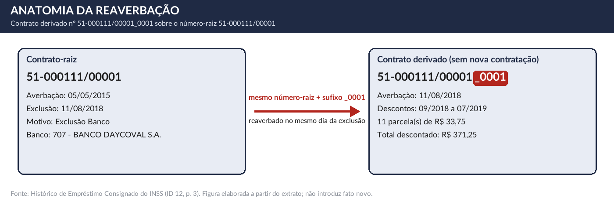
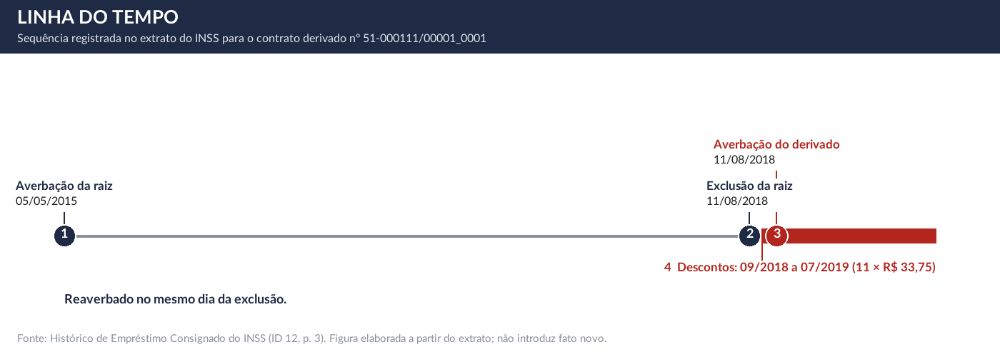

> **MINUTA DE TESTE — CASO FICTÍCIO. NÃO PROTOCOLAR.** Nenhum dado é de pessoa real (exceto a qualificação pública do réu, tirada de `references/dados/reus.json`). Gerada em 28/10/2026 a partir de `assets/modelo-inicial-tese-1000.md`, `calculo.json` e do quadro de fatos desta pasta. Premissas do teste (processo 1 do caso fictício): o advogado respondeu **JEC** ao rito e **Ilhéus - BA** à cidade do fecho; o derivado está excluído (sem tutela); a cliente confirmou a data de ciência e a reclamação prévia. **Observação interna (Título 6): remover antes de protocolar.**

AO JUÍZO DA [PREENCHER: N]ª VARA DO SISTEMA DOS JUIZADOS ESPECIAIS DA COMARCA DE ILHÉUS - BAHIA

**EMENTA:** Empréstimo consignado. Contrato derivado com sufixo numérico, averbado sobre número-raiz de contrato já excluído. Beneficiária do INSS. Ausência de nova manifestação de vontade. Inexistência do negócio jurídico. Desconto indevido sobre verba de natureza alimentar. Responsabilidade objetiva da instituição financeira. Repetição do indébito em dobro. Dano extrapatrimonial.

**MARIA DAS GRAÇAS EXEMPLO SANTOS**, brasileira, viúva, aposentada, inscrita no CPF sob nº 000.000.000-00, RG sob nº 00.000.000-00 SSP/BA, residente e domiciliada na Rua Exemplo, nº 100, Bairro Fictício, CEP 45600-000, cidade de Ilhéus/BA, por seu advogado que esta subscreve (procuração anexa), vem, respeitosamente, perante este Juízo, propor a presente

## Ação Declaratória de Inexistência de Relação Jurídica, Cumulada com Repetição do Indébito em Dobro, Obrigação de Fazer e Indenização por Danos Extrapatrimoniais

em face do **BANCO DAYCOVAL S.A.**, pessoa jurídica de direito privado, inscrito no CNPJ sob o n° 62.232.889/0001-90, com endereço na Avenida Paulista, nº 1.793, Bela Vista, São Paulo/SP, CEP 01311-200, pelos seguintes fatos, fundamentos e razões de direito.

# Da gratuidade da justiça

A parte autora não tem condições de arcar com as despesas do processo, uma vez que são insuficientes seus recursos financeiros para pagar todas as despesas processuais, inclusive o recolhimento das custas iniciais.

Requer sejam deferidos os benefícios da gratuidade da justiça, o que faz por declaração de seus advogados, nos termos do art. 99, § 4º, c/c o art. 105, in fine, ambos do CPC, prerrogativa que consta do instrumento procuratório anexo. Presume-se verdadeira a alegação de insuficiência deduzida por pessoa natural (art. 99, § 3º, do CPC). A Constituição assegura assistência jurídica integral e gratuita aos que comprovarem insuficiência de recursos (art. 5º, LXXIV, da Constituição Federal). No Juizado Especial, o acesso em primeiro grau independe do pagamento de custas, taxas ou despesas (art. 54 da Lei 9.099/95).

# Da tramitação prioritária

Conforme documento pessoal anexo (ID 3), a parte autora é pessoa idosa e faz jus à prioridade na tramitação (art. 1.048, I, do CPC; art. 71 da Lei 10.741/2003 — Estatuto da Pessoa Idosa).

# Da gratuidade da justiça

A parte autora não tem condições de arcar com as despesas do processo, uma vez que são insuficientes seus recursos financeiros para pagar todas as despesas processuais, inclusive o recolhimento das custas iniciais.

Requer sejam deferidos os benefícios da gratuidade da justiça, o que faz por declaração de seus advogados, nos termos do art. 99, § 4º, c/c o art. 105, in fine, ambos do CPC, prerrogativa que consta do instrumento procuratório anexo. Presume-se verdadeira a alegação de insuficiência deduzida por pessoa natural (art. 99, § 3º, do CPC). No Juizado Especial, o acesso em primeiro grau independe do pagamento de custas, taxas ou despesas (art. 54 da Lei 9.099/95).

# Da tramitação prioritária

Conforme documento pessoal anexo (ID 3), a parte autora é pessoa idosa e faz jus à prioridade na tramitação (art. 1.048, I, do CPC; art. 71 da Lei 10.741/2003 — Estatuto da Pessoa Idosa).

# Da competência do Juizado Especial

A causa é de competência do Juizado Especial Cível (art. 3º, I, da Lei 9.099/95): o valor da causa, R$ 20.742,50, é inferior a 40 (quarenta) salários mínimos, que, à razão de R$ 1.621,00 (Decreto 12.797/2025), correspondem a R$ 64.840,00. A prova é documental (o extrato oficial do INSS).

# Dos fatos

A parte autora é beneficiária do INSS (NB 999.999.999-9, aposentadoria por idade), e o benefício previdenciário é a sua única fonte de renda ****.

Em 10/08/2026, ao consultar o Histórico de Empréstimo Consignado emitido pelo INSS em 28/10/2026 (ID 5, p. 1), a parte autora tomou conhecimento de contrato com numeração terminada em sufixo ("_0001"), nº 51-000111/00001_0001, vinculado ao réu, com descontos nas competências de 09/2018 a 07/2019.

A análise do histórico mostra que o número-raiz do contrato derivado (51-000111/00001) é o mesmo de contrato anterior atribuído à parte autora, averbado em 05/05/2015 e excluído em 11/08/2018 (motivo registrado: "Exclusão Banco"). A reinclusão deu-se no próprio dia da exclusão: o extrato registra, em 11/08/2018, a exclusão do contrato-raiz e a averbação do contrato derivado ("Averbação nova"), sem intervalo entre uma e outra.

Esta ação tem por objeto exclusivamente o contrato derivado, sem discutir a validade do contrato-raiz já excluído. A irregularidade alegada decorre da averbação do derivado e independe da regularidade da operação anterior.

| Contrato | Papel | Averbação | Início | Fim | Parcela | Qtde. | Total descontado | Restituição (dobro) | Status |
|---|---|---|---|---|---|---|---|---|---|
| 51-000111/00001_0001 | derivado | 11/08/2018 | 09/2018 | 07/2019 | R$ 33,75 | 11 | R$ 371,25 | R$ 742,50 | EXCLUÍDO |
| 51-000111/00001 | raiz | 05/05/2015 | | | | | | | EXCLUÍDO em 11/08/2018 |
| **Total** | | | | | | | R$ 371,25 | R$ 742,50 | |

*Fonte: Histórico de Empréstimo Consignado do INSS, emitido em 28/10/2026 (ID 5, p. 1). CÁLCULO A CONFERIR.*

Sequência registrada no extrato:

*Figura 1: Anatomia da reaverbação do contrato nº 51-000111/00001_0001 (número-raiz 51-000111/00001). Fonte: Histórico de Empréstimo Consignado do INSS (ID 12, p. 3). A figura reproduz o extrato e não introduz fato novo.*

*Figura 2: Linha do tempo do contrato nº 51-000111/00001_0001, conforme o extrato do INSS (ID 12, p. 3).*

## A parte autora nega a manifestação de vontade quanto ao contrato derivado

> **Contrato nº 51-000111/00001_0001.** A parte autora nega ter firmado esse contrato, nega ter assinado nova Cédula de Crédito Bancário e nega ter autorizado a nova averbação. Entre a exclusão do contrato-raiz e a averbação do derivado, a parte autora não foi contatada, notificada ou consultada ****. O extrato do INSS registra valor liberado de R$ 337,57; a destinação desse valor incumbe ao banco demonstrar (art. 373, II, do CPC).

A parte autora não utiliza plataformas digitais de autenticação, não domina mecanismos de verificação biométrica, tokens ou senhas dinâmicas e jamais forneceu sua imagem facial, dados biométricos ou credenciais de acesso.

Em 02/09/2026, a parte autora registrou reclamação perante o banco pelo consumidor.gov.br (ID 7) e não obteve resposta.

# Do direito

## O Código de Defesa do Consumidor se aplica às instituições financeiras

Conforme a Súmula 297 do STJ, o Código de Defesa do Consumidor é aplicável às instituições financeiras.

## A responsabilidade do banco é objetiva, e a prova de excludente é dele

Dispõe o art. 14, caput e § 3º, do Código de Defesa do Consumidor:

> Art. 14. O fornecedor de serviços responde, independentemente da existência de culpa, pela reparação dos danos causados aos consumidores por defeitos relativos à prestação dos serviços, bem como por informações insuficientes ou inadequadas sobre sua fruição e riscos.
>
> § 3° O fornecedor de serviços só não será responsabilizado quando provar: I - que, tendo prestado o serviço, o defeito inexiste; II - a culpa exclusiva do consumidor ou de terceiro.

Trata-se de inversão que decorre da lei: o ônus de provar a inexistência do defeito ou a culpa exclusiva do consumidor ou de terceiro é do banco. A fraude de terceiro em operação bancária é fortuito interno e não afasta a responsabilidade (Súmula 479 do STJ).

A parte autora jamais celebrou os contratos impugnados e não deu causa aos descontos, de modo que nenhuma das excludentes se verifica. Configura-se o ato ilícito do art. 186 do Código Civil:

> Art. 186. Aquele que, por ação ou omissão voluntária, negligência ou imprudência, violar direito e causar dano a outrem, ainda que exclusivamente moral, comete ato ilícito.

Estão presentes a conduta (averbação e cobrança sem consentimento), o dano (desconto sobre verba alimentar) e o nexo causal.

## O contrato derivado é contrato novo e exigia nova contratação

O sistema do INSS, por desenho próprio, não permite reaverbação sob o mesmo número. Trata-se de barreira técnica **[CONFERIR: fonte da barreira técnica, como manual da Dataprev ou ofício do INSS; mantida por decisão do escritório (D28)]**.

A averbação do derivado em 11/08/2018 está sob a IN INSS/PRES 28/2008, vigente até 12/12/2022. Seu art. 30, IV, dispõe que o número do contrato "deve ser único e específico para cada contratação ou refinanciamento", e seu § 2º, que "o contrato celebrado não poderá ser alterado, podendo somente ocorrer a sua exclusão do sistema e averbação de um novo". O art. 5º determina que a instituição financeira somente encaminhará o arquivo para averbação **após a devida assinatura do contrato** pelo beneficiário, e o art. 6º atribui à instituição total responsabilidade pela inobservância, tornando a operação irregular e não autorizada ****.

Excluído o contrato-raiz, o que se averbou em seguida, com número diferente, é, para o sistema do INSS, **contrato novo**. Contrato novo exige contratação nova: instrumento assinado antes do envio do arquivo para averbação (art. 5º). O extrato não mostra nada disso entre a exclusão e a reinclusão.

## A inexistência do negócio decorre da ausência de consentimento quanto ao derivado

O art. 104 do Código Civil exige, para a validade do negócio jurídico, agente capaz, objeto lícito e forma prescrita ou não defesa em lei. No consignado em benefício do INSS soma-se a manifestação expressa do beneficiário (tópico anterior). Quanto ao derivado, não há registro de instrumento, de autorização ou de ato da parte autora. A prova de que existiram incumbe ao banco, por força do art. 14, § 3º, do CDC e da inversão pedida abaixo. Sem consentimento, o que existe é ato unilateral do banco, sem força obrigatória, que usa o sistema do INSS para descontar valores do benefício sem causa jurídica.

## Os valores descontados devem ser restituídos em dobro

O art. 42, parágrafo único, do Código de Defesa do Consumidor dispõe:

> Parágrafo único. O consumidor cobrado em quantia indevida tem direito à repetição do indébito, por valor igual ao dobro do que pagou em excesso, acrescido de correção monetária e juros legais, salvo hipótese de engano justificável.

O dispositivo ressalva apenas o engano justificável. Descontos mensais de contrato derivado, averbado sem nova contratação e lançado diretamente sobre verba de natureza alimentar, não decorrem de engano justificável. A parte autora pede, por isso, a restituição em dobro de **todos** os descontos.

A reclamação prévia sem resposta (ID 7) mostra que o banco foi informado de que a cobrança era indevida e manteve os descontos.

**Contrato nº 51-000111/00001_0001.** Até a presente data, a parte autora suportou 11 parcelas, cuja soma resulta em R$ 371,25 (trezentos e setenta e um reais e vinte e cinco centavos). Assim, o banco deve restituir os valores descontados em dobro, que correspondem a R$ 742,50 (setecentos e quarenta e dois reais e cinquenta centavos).

Totalizando, R$ 742,50 (setecentos e quarenta e dois reais e cinquenta centavos). ***CÁLCULO A CONFERIR.***

## O dano extrapatrimonial é devido e decorre da natureza alimentar da verba

A situação vivida pela parte autora ultrapassa o mero aborrecimento cotidiano. Os descontos incidem mensalmente sobre benefício previdenciário, de natureza alimentar, durante o período de 09/2018 a 07/2019, sem que a parte autora pudesse impedi-los na origem.

A Súmula 40 da Turma de Uniformização das Turmas Recursais do TJBA admite o dano moral por desconto indevido quando, observadas as particularidades do caso, demonstrada violação significativa a direito da personalidade. As particularidades aqui são: a natureza alimentar do benefício, o valor e a duração dos descontos, a condição de pessoa idosa e as tentativas de solução junto ao banco (ID 7). A jurisprudência do STJ e dos tribunais estaduais reconhece a presunção do dano moral nos descontos indevidos sobre benefício previdenciário **[VERIFICAR ANTES DE PROTOCOLAR: indicar os julgados; nenhum consta do acervo, e a Súmula 40 do TJBA diz que o desconto indevido, por si só, não configura dano moral; mantido por decisão do escritório (D28)]**.

Além da função compensatória, a indenização cumpre função pedagógica: o valor deve ser suficiente para desestimular a repetição da conduta por instituição de grande porte. Considerados o porte econômico do banco, a gravidade da falha e o caráter alimentar da verba, o valor de **R$ 20.000,00 (vinte mil reais)** é justo e razoável e não gera enriquecimento sem causa. O valor é estimativo: conforme a Súmula 326 do STJ, a condenação em montante inferior ao postulado na inicial não implica sucumbência recíproca.

## A pretensão não está prescrita

Por cautela, afasta-se desde logo a alegação de prescrição. A pretensão não decorre de defeito de serviço contratado, mas da cobrança de valores sem lastro contratual, por averbação que a parte autora jamais autorizou. A Corte Especial do STJ decidiu, em caso de cobrança de serviços não contratados de telefonia fixa, que a repetição de indébito prescreve em dez anos, pelo art. 205 do Código Civil, e não em três **(EAREsp 738.991/RS, Rel. Min. Og Fernandes, j. 20/02/2019, DJe 11/06/2019; julgado de telefonia fixa, aplicado ao consignado por analogia)**.¹ Além disso, a declaração de inexistência da relação jurídica não está sujeita a prazo prescricional: o negócio nulo não convalesce pelo decurso do tempo (art. 169 do CC).

Subsidiariamente, ainda que se aplicasse o prazo quinquenal do art. 27 do CDC, ele só começa a correr do conhecimento do dano e de sua autoria. A parte autora só soube da origem dos descontos em 10/08/2026, pelo Histórico de Empréstimo Consignado emitido em 28/10/2026. Sustenta-se, portanto, o prazo decenal do art. 205 do Código Civil (decisão do escritório). **[DECISÃO DO ADVOGADO: termo inicial do prazo]**

¹ BRASIL. Superior Tribunal de Justiça. Corte Especial. Embargos de Divergência em Agravo em Recurso Especial n. 738.991/RS. Relator: Ministro Og Fernandes. Julgado em: 20 fev. 2019. Publicado no DJe em: 11 jun. 2019.

# Da inversão do ônus da prova

O ônus de provar a regularidade do derivado é do banco por força de lei, independentemente de decisão judicial: art. 14, § 3º, do CDC e, quando se impugna a autenticidade da assinatura, art. 429, II, do CPC, com o Tema Repetitivo 1061 do STJ.² A inversão judicial do art. 6º, VIII, do CDC reforça esse resultado:

> Art. 6º São direitos básicos do consumidor: (...) VIII - a facilitação da defesa de seus direitos, inclusive com a inversão do ônus da prova, a seu favor, no processo civil, quando, a critério do juiz, for verossímil a alegação ou quando for ele hipossuficiente, segundo as regras ordinárias de experiências;

² BRASIL. Superior Tribunal de Justiça. Segunda Seção. Tema Repetitivo 1061. Recurso Especial n. 1.846.649/MA. Relator: Ministro Marco Aurélio Bellizze. Julgado em: 24 nov. 2021. Publicado no DJe em: 9 dez. 2021.

A verossimilhança está no próprio extrato: o mesmo número-raiz, a exclusão e a reinclusão no mesmo dia. A hipossuficiência é técnica: contrato, autenticação e crédito estão sob domínio exclusivo do banco. Requer-se a inversão e que o banco junte, **com a contestação**, os documentos abaixo, para cada derivado:

| Documento | Fundamento | Se não for apresentado |
|---|---|---|
| Instrumento contratual próprio do derivado (CCB), datado da averbação | Art. 429, II, do CPC; Tema 1061/STJ; IN 28/2008, art. 5º (até 12/12/2022) | O fato impeditivo não está provado, e isso se valora contra o banco (art. 373, II, do CPC) |
| Autorização expressa da consignação do derivado | IN 28/2008, art. 5º (até 12/12/2022) | Mesma consequência |
| Comprovante do crédito de valor novo em conta de titularidade da parte autora, idêntico ao liberado no extrato | Art. 14, § 3º, do CDC; art. 373, II, do CPC | Mesma consequência |
| Registro do motivo da exclusão do contrato-raiz e da razão da averbação do derivado | Art. 373, II, do CPC | Mesma consequência |

Nos Juizados Especiais não se pede perícia nem exibição autônoma: a juntada dos documentos acima decorre do ônus do banco, e a omissão é valorada contra ele.

# Dos precedentes judiciais evocados ao caso concreto

Precedentes evocados nesta peça: Súmula 297/STJ (tópico "Do direito", subtópico 1); Súmula 479/STJ (tópico "Do direito", subtópico 2); Súmula 40 da Turma de Uniformização do TJBA (subtópico do dano); Súmula 326/STJ (sucumbência recíproca no dano moral); Tema 1061/STJ (tópico da inversão do ônus); EAREsp 738.991/RS (subtópico da prescrição).

O Código de Processo Civil estabelece sistema de precedentes destinado a assegurar coerência e integridade aos julgamentos, de modo que decisões sobre o mesmo tema e as mesmas circunstâncias não destoem entre si.

Nos Juizados Especiais, a sentença segue o art. 38 da Lei 9.099/95, que dispensa o relatório, mas exige que mencione os elementos de convicção do Juiz. O art. 489, § 1º, VI, do CPC é compatível com os critérios do art. 2º da mesma lei e é invocado aqui como parâmetro para o enfrentamento dos precedentes.

Nesse sentido, dispõe o art. 489, § 1º, VI:

> Art. 489. (...).
>
> § 1º Não se considera fundamentada qualquer decisão judicial, seja ela interlocutória, sentença ou acórdão, que:
>
> (...)
>
> VI - deixar de seguir enunciado de súmula, jurisprudência ou precedente invocado pela parte, sem demonstrar a existência de distinção no caso em julgamento ou a superação do entendimento.

A norma impõe que, uma vez invocado precedente pela parte, o julgador que pretenda decidir em sentido diverso deve, de forma expressa e fundamentada, distingui-lo do caso concreto (*distinguishing*) ou justificar sua superação (*overruling*), sob pena de a decisão ser tida por não fundamentada.

O *distinguishing* pressupõe ausência de coincidência entre os fatos da demanda e a tese jurídica que sustentou o precedente, ou peculiaridade do caso concreto que afaste a aplicação de sua *ratio decidendi*. Mesmo diante de precedente vinculante, essa distinção deve ser feita de forma expressa e fundamentada, e não presumida.³

O *overruling*, por sua vez, pressupõe que o precedente já não se sustenta, apurando-se sua consistência sistêmica e congruência social por meio do denominado *basic overruling principle*. Falhando em qualquer desses aspectos, a superação também deve ser expressamente justificada.⁴

Requer-se a apreciação de cada um dos precedentes evocados de forma expressa, promovendo a distinção ou a superação que entender cabível, mas sempre de modo fundamentado, nos termos do art. 489, § 1º, VI, do CPC, sob pena de a decisão incorrer em vício apto a ensejar embargos de declaração.

³ DONIZETTI, Elpídio. **A Força dos Precedentes do Novo Código de Processo Civil**. 2018. Disponível em: https://elpidiodonizetti.jusbrasil.com.br/artigos/155178268/a-forca-dos-precedentes-do-novo-codigo-de-processo-civil.

⁴ FENSTERSEIFER, Wagner Arnold. Distinguishing e overruling na aplicação do art. 489, § 1.º, VI, do CPC/2015. **Revista de Processo**, São Paulo, v. 252. Editora Revista dos Tribunais, 2017.

# Do preenchimento do campo "Motivo da Exclusão" no sistema eConsignado/DATAPREV

O extrato do Histórico de Empréstimo Consignado é gerado a partir do sistema eConsignado, mantido pelo INSS em conjunto com a Dataprev, e constitui o repositório do histórico consignatário do beneficiário. Esse repositório é consultado pelas instituições financeiras habilitadas antes de nova averbação, de modo que o que nele consta, e o que deixa de constar, produz efeitos continuados sobre a vida financeira do titular.

O sistema estrutura a baixa de contratos em três campos:

| Campo | Quem preenche | Situação no caso |
|---|---|---|
| Data da Exclusão | Sistema, automaticamente | Preenchida |
| Origem da Exclusão | A própria instituição financeira, de forma unilateral (por exemplo, "Exclusão Banco", "Exclusão por portabilidade") | Preenchida; não se pede a sua alteração |
| Motivo da Exclusão | Campo destinado ao registro da causa jurídica da baixa | Em branco: é este o campo que se pede preencher |

A parte autora não pretende alterar o campo "Origem da Exclusão". Pretende apenas o preenchimento do campo "Motivo da Exclusão", hoje vazio, com a expressão "Por força de decisão judicial". A providência tem custo operacional irrisório e traz vantagens verificáveis ao consumidor:

| # | Vantagem | Fundamento |
|---|---|---|
| 1 | Impede a reaverbação do mesmo contrato sob numeração distinta (linha derivada de contratos) | CPC, art. 497 |
| 2 | Documenta a irregularidade no histórico oficial, tornando-a oponível a futuras instituições consulentes | CDC, art. 43 |
| 3 | Libera a margem consignável de forma documentada | CDC, art. 6º, VI |
| 4 | Impede que a baixa seja revertida por lançamento posterior | CPC, art. 497; CC, art. 422 **[CONFERIR: adequação do fundamento]** |

Tratando-se de contrato já excluído, a exclusão já ocorreu e o campo permanece vazio, de modo que o provimento consiste na simples complementação do registro histórico.

# Das provas

Protesta provar o alegado por todos os meios admitidos em direito (art. 369 do CPC), especialmente a prova documental anexa e o depoimento pessoal do representante do réu, bem como os documentos que o banco deva juntar.

# Dos pedidos

Diante do exposto, requer:

a) o deferimento da gratuidade da justiça (arts. 98 e 99, caput e § 3º, do CPC; art. 54 da Lei 9.099/95);

b) a prioridade de tramitação (art. 1.048, I, do CPC; art. 71 da Lei 10.741/2003);

c) a citação do réu para que apresente contestação no prazo legal, sob pena de revelia, manifestando a parte autora interesse na audiência de conciliação;

e) a inversão do ônus da prova, com o encargo de o réu juntar, com a contestação, os documentos do tópico "Da inversão do ônus da prova";

f) a apreciação expressa de cada precedente evocado, nos termos do art. 489, § 1º, VI, do CPC;

g) a procedência dos pedidos, concedida em sentença, para que:

1. seja declarada a inexistência da relação jurídica entre as partes quanto ao contrato derivado nº 51-000111/00001_0001 e, subsidiariamente, a sua nulidade, com a inexigibilidade de todo e qualquer débito decorrente, sem que isso importe declaração sobre o contrato-raiz nº 51-000111/00001;
2. o réu seja condenado à obrigação de fazer de manter a baixa do derivado e de não restabelecer a margem comprometida;
3. o réu seja condenado à obrigação de não fazer: não averbar de novo o contrato-raiz nº 51-000111/00001 sob qualquer sufixo ou numeração, não descontar, não cobrar, não inscrever a parte autora em cadastros restritivos e não ceder a terceiros o crédito impugnado;
4. o réu seja condenado à obrigação de fazer de preencher, no sistema eConsignado/DATAPREV, o campo "Motivo da Exclusão", hoje em branco, com a expressão "Por força de decisão judicial", mantido inalterado o campo "Origem da Exclusão", em 10 (dez) dias úteis, sob pena de multa diária de R$ 500,00, nos termos dos arts. 497 e 537 do CPC;
5. o réu seja condenado a restituir em dobro os valores descontados, no total atual de R$ 742,50 (setecentos e quarenta e dois reais e cinquenta centavos), assim discriminados: contrato nº 51-000111/00001_0001, R$ 742,50 (setecentos e quarenta e dois reais e cinquenta centavos). Correção monetária desde a data de cada desconto (Súmula 43 do STJ) e juros moratórios a contar do evento danoso (Súmula 54 do STJ). Requer-se que os descontos posteriores a esta petição, até o trânsito em julgado, sejam apurados na liquidação;
6. o réu seja condenado ao pagamento de indenização por danos extrapatrimoniais de **R$ 20.000,00 (vinte mil reais)**, com correção monetária desde o arbitramento (Súmula 362 do STJ) e juros de mora desde o evento danoso (Súmula 54 do STJ);
7. seja vedada a compensação entre eventual valor comprovadamente creditado à parte autora e a indenização por dano extrapatrimonial, que tem causa e função distintas, restringindo-se eventual acerto à restituição (art. 182 do CC);

(Sem pedido de custas e honorários: a sentença de primeiro grau não condena o vencido, salvo litigância de má-fé — art. 55 da Lei 9.099/95.)

Requer, ainda, que todas as intimações e publicações sejam feitas exclusivamente em nome de **[PREENCHER: advogado subscritor e OAB]**.

# Do valor da causa

Dá-se à causa o valor de R$ 20.742,50 (vinte mil, setecentos e quarenta e dois reais e cinquenta centavos), correspondente à restituição em dobro (R$ 742,50) e ao dano extrapatrimonial (R$ 20.000,00) (art. 292 do CPC). *CÁLCULO A CONFERIR.*

Termos em que, pede deferimento.

Ilhéus - BA, 28 de outubro de 2026.

**[PREENCHER: NOME DO ADVOGADO]**
OAB/BA nº **[PREENCHER]**
